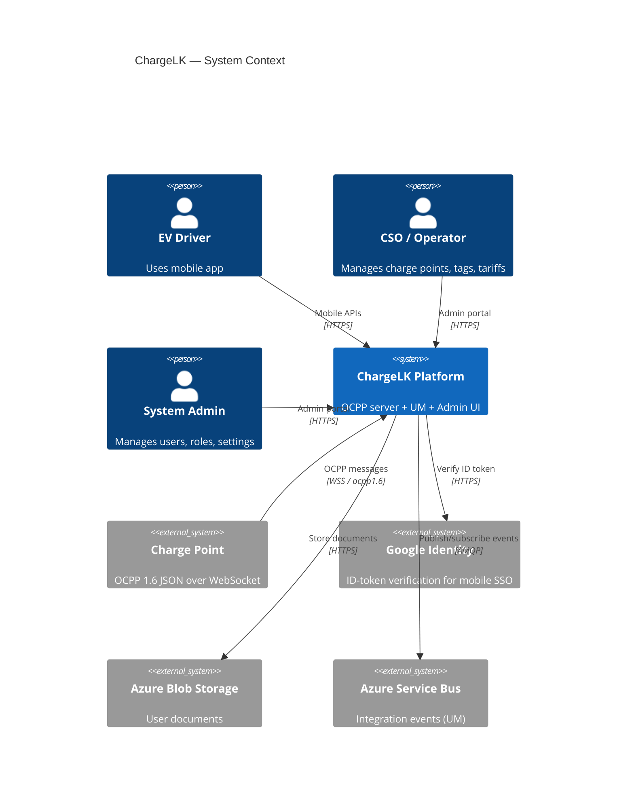
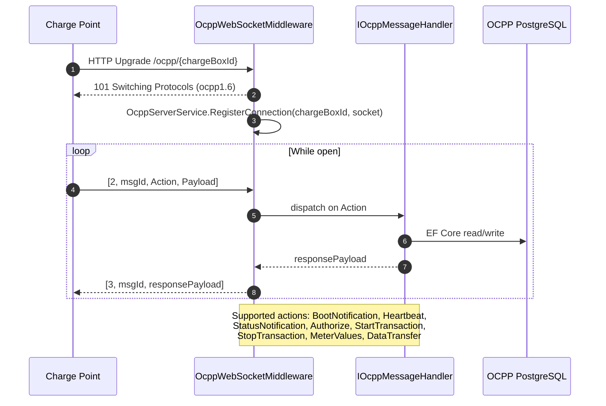
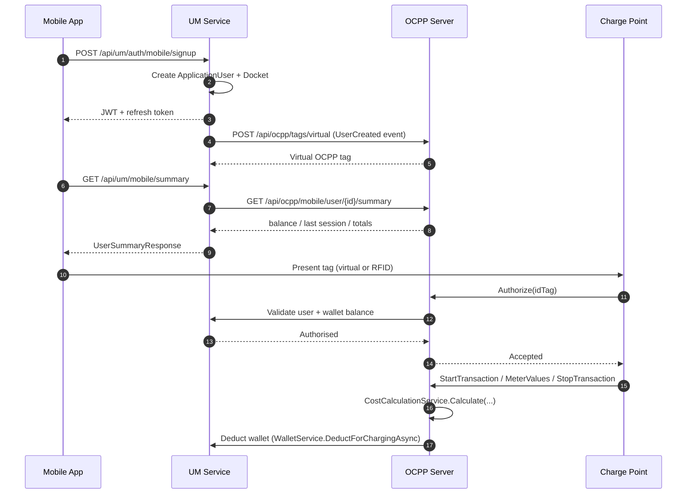

# System Architecture

## Overview

ChargeLK is composed of two independent .NET 9 microservices (OCPP Server, User Management) and a React admin portal. Each backend service follows a four-layer Clean Architecture:

```
API  →  Application  →  Domain
 │                        ▲
 └──►  Infrastructure  ───┘
```

The two solutions are **physically separate** (`ChargeLK.OCPPServer/` and `ChargeLK.UM/`) and do not share compiled projects. Integration is done over HTTP (UM calls OCPP mobile endpoints under `/api/ocpp/*`, OCPP calls UM to validate users/tags) and, in UM, via Azure Service Bus.

## Architectural Principles

1. **Clean Architecture per service** — dependencies point inward (API → Application → Domain; Infrastructure → Application/Domain).
2. **CQRS with MediatR** — commands and queries are handled by dedicated handlers (e.g. `OcppServer.Application/Handlers/ChargePoint/{Commands,Queries}`).
3. **Permission-based authorisation (UM)** — `resource:action` strings resolved dynamically through a custom `PermissionPolicyProvider`; OCPP server uses named policies like `CanManageChargePoints`.
4. **Domain events** — entities raise events (e.g. `UserCreatedDomainEvent`) that are handled by Application-layer `INotificationHandler`s, and can be forwarded to Azure Service Bus.
5. **Repository + Unit of Work** — all data access goes through repositories (`ChargeLK.Infrastructure/Repositories/*`, `OcppServer.Infrastructure/Repositories/*`) with `IUnitOfWork` for transactional boundaries.
6. **Thin controllers** — controllers just dispatch through `Mediator.Send(...)` and translate `Result<T>` / `Result<T, Error>` into HTTP responses (`BaseApiController`).

## Layer Map

### OCPP Server (`ChargeLK.OCPPServer/`)
- `OcppServer.Domain/` — `ChargePointEntity`, `Connector`, `TransactionEntity`, `TransactionMeterValue`, `OcppTag`, `OcppTagAuditLog`, `OcppOperation`, `Reservation`, `Tariff`, `ChargerMaintenanceEntity`, `ChargerReview`, `ChargingProfile`, `ChargingSchedulePeriod`, plus `Enums/` and `Shared/`.
- `OcppServer.Application/` — `Handlers/{ChargePoint,Transaction,OcppTag,Tariff,ChargerMaintenance,Mobile}` (Commands + Queries), `DTOs/*`, `Interfaces/{Data,Ocpp,Repositories,Services,User}`, `Results/`.
- `OcppServer.Infrastructure/` — `Persistence/` (EF Core PostgreSQL `DbContext`), `EntityConfigurations/`, `Migrations/`, `Repositories/`, `Interceptors/`, `Services/{Billing,Ocpp,Tag,Time,User}`, `Configs/`.
- `OcppServer.API/` — `Controllers/RestApi/{ChargePoints,ChargerMaintenance,Mobile,OcppTags,Reviews,Tariffs,Transactions}`, `Middlewares/{OcppWebSocketMiddleware, RequestContextLoggingMiddleware}`, `Extentions/` (sic: `ServiceCollectionExtensions`, `MigrationExtentions`, `FileUploadOperationFilter`).

### User Management (`ChargeLK.UM/`)
- `ChargeLK.Domain/` — `Entities/{User,Wallet,Documents,Dockets,ChargingSession,Settings}`, `DomainEvents/Users/Events` (`UserCreatedDomainEvent`, `CreateBlobContainerEvent`), `Constants/{Roles, Permissions, CustomClaimTypes, AuthenticationSchemes}`, `Configs/{TokenConfig, GoogleAuthConfig}`, `Shared/{EntitySupport, Enums, BusinessExceptions, Repository}`.
- `ChargeLK.Application/` — `Handlers/{Auth,User,Role,Permission,Mobile,Document,Settings,DomainEvents}`, `Behaviors/{ValidationPipelineBehavior, RequestLoggingPipelineBehavior}`, `Interfaces/*`, `Models/*`, `Services/`.
- `ChargeLK.Infrastructure/` — `Database/` (EF Core PostgreSQL + Identity), `EntityConfigurations/*`, `Migrations/`, `Repositories/*`, `Services/{Authentication,Document,Messaging,Permission,Time,Token,User,Wallet}`, `Authorization/{PermissionPolicyProvider, PermissionAuthorizationHandler, PermissionRequirement}`, `Interceptors/AuditableEntitySaveChangesInterceptor`.
- `ChargeLK.API/` — `Controllers/RestApi/{Admin,ApplicationUser,Document,Mobile,Settings,Wallet}`, `Extensions/*`, `Middleware/RequestContextLoggingMiddleware`, `Constants/{PolicyNames, AuthorizationPolicies}`.

### Admin UI (`ChargeLK.AdminUI/`)
- `src/pages/` — page-level components (`Dashboard`, `ChargePoints`, `ChargePointDetail`, `OcppTags`, `Transactions`, `Users`, `Settings`, `Login`).
- `src/components/` — shared/layout + feature folders (`Layout`, `OcppTags`, `Users`, `QrCode`).
- `src/store/` — Redux store; `api/{baseApi, authApi, chargePointsApi, ocppTagsApi, rolesApi, settingsApi, transactionsApi, usersApi}`; `slices/authSlice.ts`.

## C4 — Context



## C4 — Containers

```mermaid
C4Container
    title ChargeLK — Container View

    Person(user, "User", "Driver / Operator / Admin")
    System_Ext(cp, "Charge Point", "OCPP 1.6")

    Container_Boundary(platform, "ChargeLK Platform") {
        Container(adminUI, "Admin UI",    "React 18 + Vite + MUI + RTK Query", "Portal for operators and admins")
        Container(mobile,  "Mobile App",  "(external / planned)",              "Driver app")

        Container(ocpp, "OCPP Server", ".NET 9 ASP.NET Core",
            "OCPP 1.6 WebSocket + REST for charge points, tariffs, tags, reviews, maintenance, transactions")
        Container(um,   "UM Service",  ".NET 9 ASP.NET Core",
            "Identity, RBAC/permissions, wallet, documents/dockets, mobile auth, settings")

        ContainerDb(pgOcpp, "OCPP PostgreSQL", "PostgreSQL",
            "Charge points, connectors, tags, transactions, meter values, tariffs, reviews, maintenance")
        ContainerDb(pgUm,   "UM PostgreSQL",   "PostgreSQL",
            "Identity users/roles/claims, permissions, dockets, documents, wallets, sessions, settings")

        Container(blob, "Blob Storage",   "Azure.Storage.Blobs", "User documents + thumbnails")
        Container(sb,   "Service Bus",    "Azure.Messaging.ServiceBus", "Integration events (UM)")
    }

    Rel(user,    adminUI, "HTTPS")
    Rel(adminUI, ocpp,    "REST /api/*",  "HTTPS")
    Rel(adminUI, um,      "REST /api/*",  "HTTPS")
    Rel(mobile,  um,      "REST /api/um/auth/mobile/*, /api/um/mobile/*", "HTTPS")

    Rel(cp, ocpp, "WSS /ocpp/{chargeBoxId}", "ocpp1.6")

    Rel(um,   ocpp, "POST /api/ocpp/tags/virtual, GET /api/ocpp/mobile/user/{id}/...", "HTTPS")
    Rel(ocpp, um,   "Resolve user / validate tag (ICurrentUserService, HTTP clients)", "HTTPS")

    Rel(ocpp, pgOcpp, "EF Core 8")
    Rel(um,   pgUm,   "EF Core 9 + Identity")
    Rel(um,   blob,   "Documents")
    Rel(um,   sb,     "Publish/Subscribe")
```

## OCPP WebSocket Flow



## Mobile Charging Session Flow



## Technology Stack

### Backend (both services)

| Component             | Version                        |
|----------------------|--------------------------------|
| .NET                 | 9.0                            |
| ASP.NET Core         | 9.0                            |
| EF Core              | 9.0 (UM), 8.0 (OCPP)           |
| PostgreSQL provider  | `Npgsql.EntityFrameworkCore.PostgreSQL` |
| MediatR              | 12.4.1                         |
| JWT Bearer           | `Microsoft.AspNetCore.Authentication.JwtBearer` |
| Identity             | `Microsoft.AspNetCore.Identity.EntityFrameworkCore` 9 (UM only) |
| Logging              | Serilog + `Serilog.Sinks.Seq`  |
| API docs             | Swashbuckle (`UseSwaggerWithUi()`) |
| Health checks        | `AspNetCore.HealthChecks.*` at `/health` |

### UM-only Infrastructure

| Concern            | Package                          |
|--------------------|----------------------------------|
| Google Sign-In     | `Google.Apis.Auth` 1.68          |
| Google OAuth       | `Microsoft.AspNetCore.Authentication.Google` |
| Blob storage       | `Azure.Storage.Blobs` 12.23      |
| Thumbnails         | `SixLabors.ImageSharp` 3.1       |
| Service Bus        | `Azure.Messaging.ServiceBus` 7.18 |
| Azure auth         | `Azure.Identity` 1.13            |
| EF naming          | `EFCore.NamingConventions` (snake_case) |
| Mongo driver (ref) | `MongoDB.Driver` 3.1 (referenced; no active DbContext in tree) |

### Frontend (ChargeLK.AdminUI)

| Component           | Version            |
|---------------------|--------------------|
| React               | 18.3               |
| TypeScript          | 5.6                |
| Vite                | 5.4                |
| Material UI         | 6.1                |
| `@mui/x-data-grid`  | 7.22               |
| `@mui/x-date-pickers`| 7.22              |
| Redux Toolkit       | 2.x                |
| RTK Query           | (bundled)          |
| redux-persist       | 6.x                |
| react-router-dom    | 6.28               |
| Recharts            | 2.14               |
| framer-motion       | 12.23              |
| notistack           | 3.0                |
| qrcode.react        | 4.2                |
| html2canvas         | 1.4                |
| jspdf               | 3.0                |

## Deployment Shape

- **OCPP Server** — published via `.github/workflows/deploy.yml`: restore → build → test → publish → `dotnet ef migrations bundle` → SCP to server → run bundle → restart `chargelk-ocpp-imesh.service`. Migrations in production are applied by the bundle, not by `ApplyMigrations()` (Development-only).
- **UM Service** — `Dockerfile` at solution root; intended to run containerised.
- **Admin UI** — `Dockerfile` + `nginx.conf`; multi-stage Node build → nginx runtime.

## Cross-Cutting Concerns

| Concern                | Where                                                                 |
|------------------------|----------------------------------------------------------------------|
| Request correlation    | `RequestContextLoggingMiddleware` (both services)                    |
| Audit fields           | `AuditableEntitySaveChangesInterceptor` (UM) + `IAuditableEntity`    |
| Validation             | `ValidationPipelineBehavior` (UM — MediatR behavior)                 |
| Request logging        | `RequestLoggingPipelineBehavior` (UM — MediatR behavior)             |
| Token validation       | Shared JWT scheme; `JwtSecurityTokenValidator` (UM)                  |
| Permission resolution  | `PermissionClaimsTransformation` + `PermissionAuthorizationHandler`  |
| Current user accessor  | `ICurrentUserService` / `CurrentUserService` (both services)         |

## Related Documentation

- [Components Documentation](../03-Components/README.md)
- [API Reference](../04-API-Reference/README.md)
- [Data Architecture](../05-Data-Architecture/README.md)
- [Infrastructure](../06-Infrastructure/README.md)
- [Security](../08-Security/README.md)
