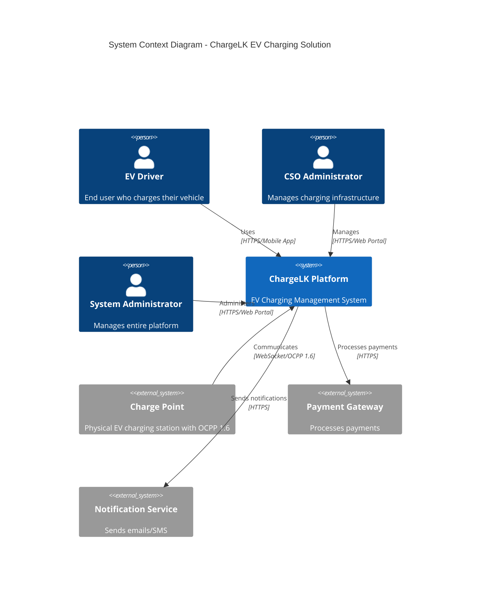
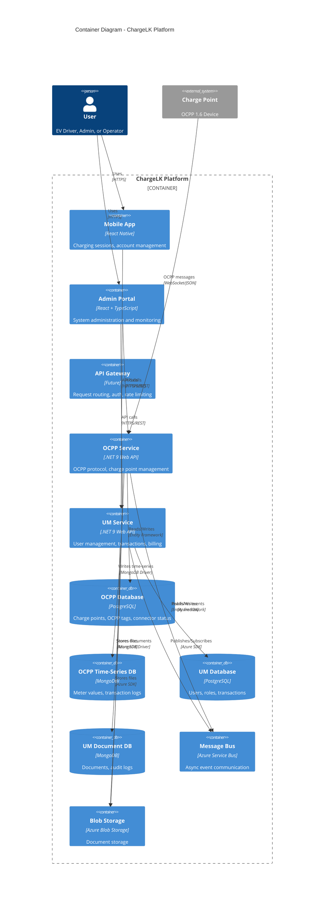
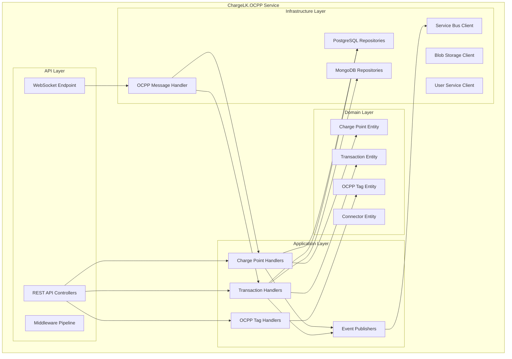
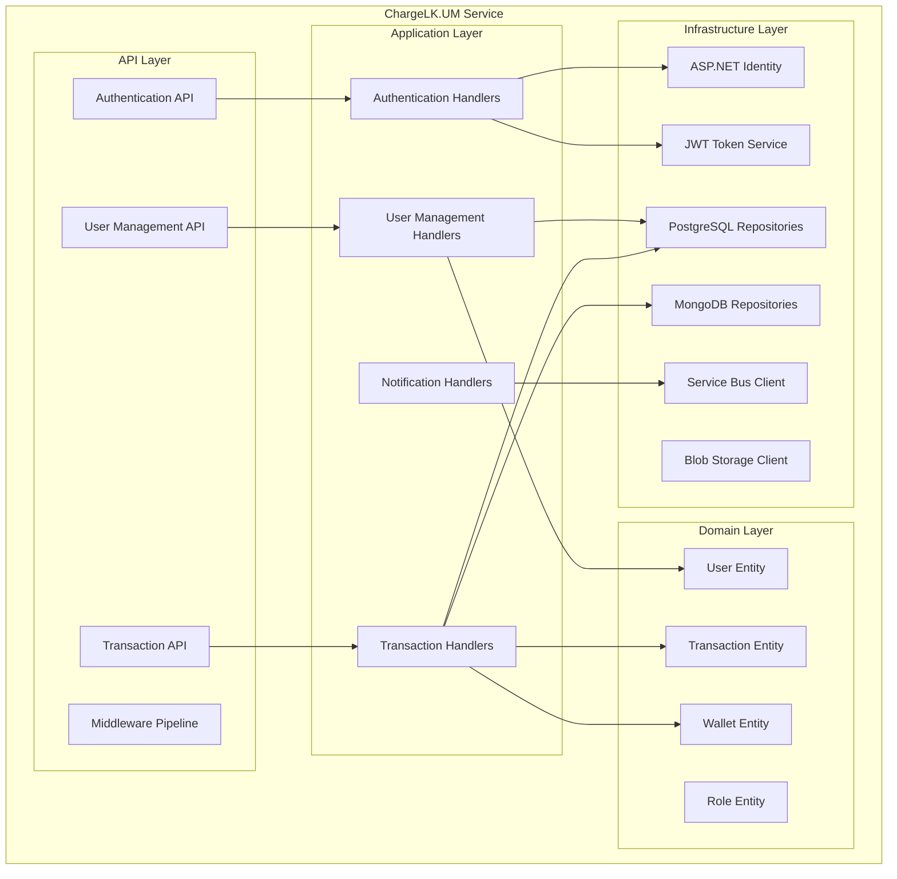

# System Architecture

## Architecture Overview

ChargeLK follows a microservices architecture pattern with clear separation of concerns, enabling independent scaling, deployment, and development of different system components.

## Architecture Principles

### 1. **Microservices Architecture**
Each service is independently deployable, scalable, and maintainable:
- **ChargeLK.OCPP**: Handles OCPP protocol and charge point management
- **ChargeLK.UM**: Handles user management and business transactions

### 2. **Clean Architecture**
Both backend services follow Clean Architecture principles:
- **Domain Layer**: Business entities and rules
- **Application Layer**: Use cases and business logic
- **Infrastructure Layer**: External concerns (database, messaging, APIs)
- **Presentation Layer**: API controllers and endpoints

### 3. **Event-Driven Communication**
Services communicate asynchronously using Azure Service Bus:
- Loose coupling between services
- Eventual consistency
- Scalable message processing

### 4. **API Gateway Pattern** (Ready for Implementation)
Single entry point for clients:
- Request routing
- Authentication/Authorization
- Rate limiting
- API composition

### 5. **Database per Service**
Each microservice has its own database:
- Data isolation and autonomy
- Independent scaling
- Technology diversity (PostgreSQL + MongoDB)

## C4 Model Architecture Diagrams

### Level 1: System Context Diagram



### Level 2: Container Diagram



### Level 3: Component Diagram - OCPP Service



### Level 3: Component Diagram - UM Service



## Technology Stack

### Backend Services (.NET)

| Component | Technology | Version | Purpose |
|-----------|-----------|---------|---------|
| Framework | .NET | 8.0 | Application runtime |
| Web Framework | ASP.NET Core | 8.0 | Web API and WebSocket |
| ORM | Entity Framework Core | 8.0 | Database access |
| Identity | ASP.NET Identity | 8.0 | User authentication |
| Logging | Serilog | Latest | Structured logging |
| API Documentation | Swagger/OpenAPI | 3.0 | API documentation |
| Testing | xUnit | Latest | Unit and integration tests |

### Frontend (Admin Portal)

| Component | Technology | Version | Purpose |
|-----------|-----------|---------|---------|
| Framework | React | 18 | UI framework |
| Language | TypeScript | Latest | Type-safe development |
| Build Tool | Vite | Latest | Fast builds and HMR |
| UI Library | Material-UI (MUI) | 6.x | Component library |
| State Management | Zustand | 5.x | Lightweight state management |
| Data Fetching | TanStack Query | 5.x | Server state management |
| HTTP Client | Axios | Latest | API communication |
| Routing | React Router | 6.x | Client-side routing |
| Charts | Recharts | 2.x | Data visualization |

### Databases

| Database | Use Case | Data Type |
|----------|----------|-----------|
| PostgreSQL | Primary relational data | Users, charge points, transactions |
| MongoDB | Time-series & documents | Meter values, logs, audit trails |

### Cloud Infrastructure (Azure)

| Service | Purpose |
|---------|---------|
| Azure Service Bus | Message broker for event-driven communication |
| Azure Blob Storage | Document and file storage |
| Azure Container Registry | Docker image storage |
| Azure App Service / AKS | Application hosting |
| Azure Monitor | Application monitoring and logging |

### DevOps & Tools

| Tool | Purpose |
|------|---------|
| Docker | Containerization |
| Docker Compose | Local development orchestration |
| Git | Version control |
| GitHub Actions | CI/CD pipeline |

## Architecture Patterns

### 1. Clean Architecture (Backend Services)

```
┌─────────────────────────────────────────────┐
│          Presentation Layer (API)           │
│  - Controllers                              │
│  - Middleware                               │
│  - WebSocket Handlers                       │
└────────────────┬────────────────────────────┘
                 │
┌────────────────▼────────────────────────────┐
│        Application Layer                    │
│  - Use Cases (Handlers)                     │
│  - DTOs & Mapping                           │
│  - Interfaces                               │
└────────────────┬────────────────────────────┘
                 │
┌────────────────▼────────────────────────────┐
│           Domain Layer                      │
│  - Entities                                 │
│  - Domain Events                            │
│  - Business Rules                           │
└────────────────┬────────────────────────────┘
                 │
┌────────────────▼────────────────────────────┐
│       Infrastructure Layer                  │
│  - Database Context                         │
│  - Repositories                             │
│  - External Services                        │
│  - Message Bus                              │
└─────────────────────────────────────────────┘
```

### 2. CQRS (Command Query Responsibility Segregation)

Implemented using MediatR pattern:
- **Commands**: Write operations (Create, Update, Delete)
- **Queries**: Read operations (Get, List, Search)
- Separate models for read and write operations

### 3. Repository Pattern

Abstracts data access logic:
- Interface-based repositories in Application layer
- Concrete implementations in Infrastructure layer
- Enables testing with mock repositories

### 4. Event-Driven Architecture

Asynchronous communication between services:
- Domain events published to Azure Service Bus
- Event handlers subscribe to topics
- Ensures loose coupling and scalability

## Non-Functional Requirements

### Performance
- API response time: < 200ms (P95)
- WebSocket message processing: < 50ms
- Support 10,000+ concurrent WebSocket connections
- Database query optimization with indexes

### Scalability
- Horizontal scaling of API services
- Stateless service design
- Database read replicas for query scaling
- Message queue for async processing

### Reliability
- 99.9% uptime SLA
- Automatic retry mechanisms
- Circuit breaker pattern for external services
- Health checks and monitoring

### Security
- TLS 1.2+ for all communications
- JWT-based authentication
- Role-based authorization
- Input validation and sanitization
- Rate limiting and DDoS protection

### Maintainability
- Clean code principles
- Comprehensive documentation
- Automated testing (Unit, Integration, E2E)
- CI/CD automation
- Logging and monitoring

## Related Documentation

- [Components Documentation](../03-Components/README.md)
- [Data Architecture](../05-Data-Architecture/README.md)
- [Infrastructure & Deployment](../06-Infrastructure/README.md)

