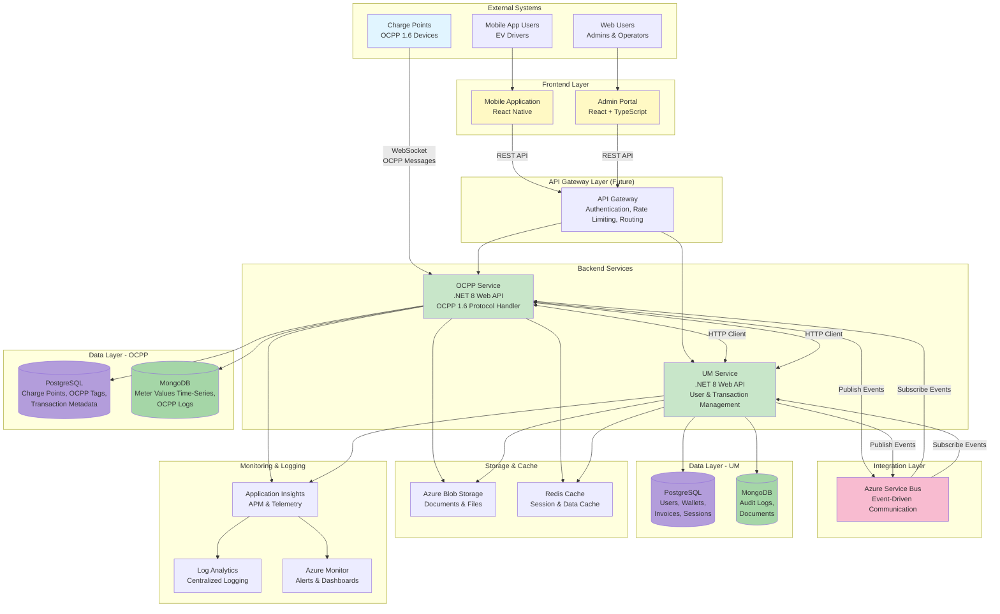
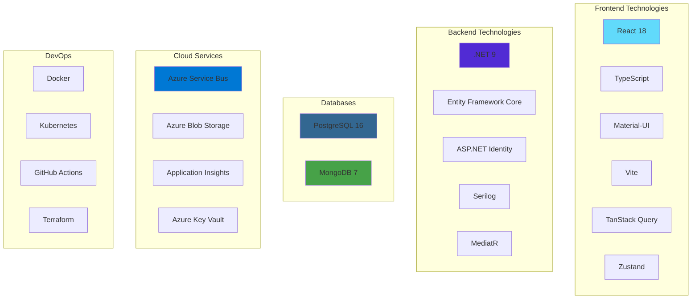
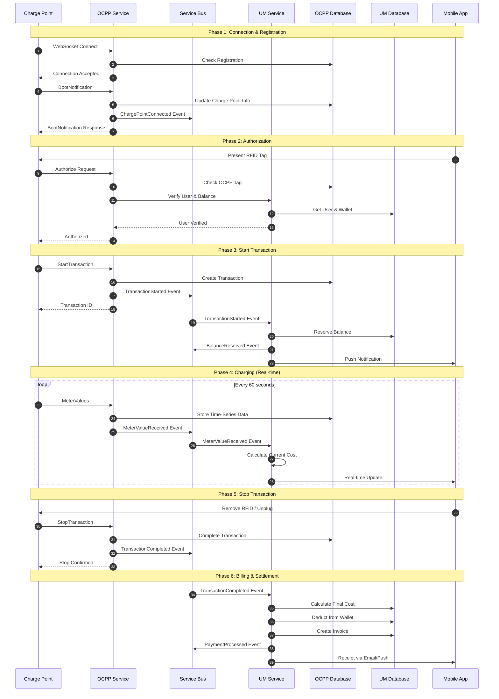
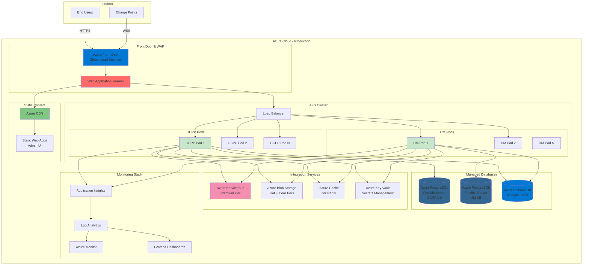
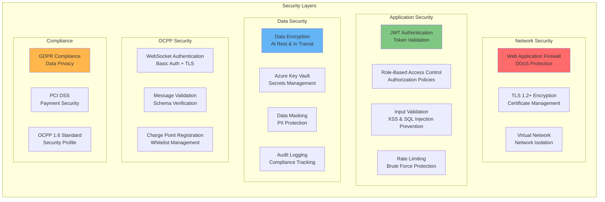
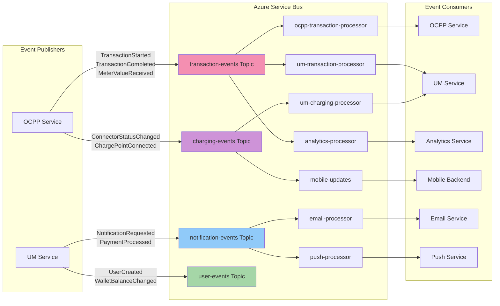
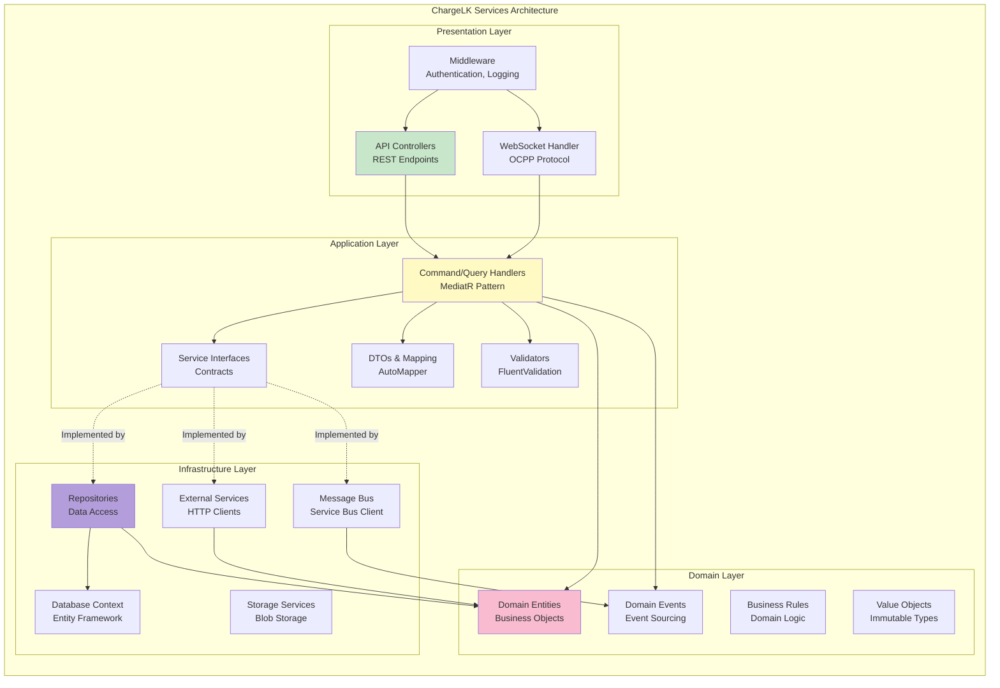

# System Architecture Diagrams - Visual Summary

This document provides a comprehensive visual overview of the ChargeLK system architecture.

## Complete System Architecture

## Technology Stack Overview

## Data Flow - Complete Transaction Lifecycle

## Deployment Architecture - Production

## Security Architecture

## Event-Driven Architecture Flow

## Clean Architecture Layers

---

## Diagram Legend

### Color Coding

| Color | Meaning |
|-------|---------|
| 🟢 Green | Backend Services |
| 🟡 Yellow | Frontend/UI |
| 🔵 Blue | Azure Services |
| 🟣 Purple | Databases |
| 🔴 Red | Security Components |
| 🟠 Orange | Monitoring/Logging |
| 🌸 Pink | Messaging/Events |

### Icons & Symbols

- **Cylinder**: Database
- **Rectangle**: Service/Application
- **Diamond**: Decision Point
- **Circle**: External System
- **Cloud**: Cloud Service
- **Arrows**: Data Flow Direction

---

## Related Documentation

- [Architecture Overview](./02-Architecture/README.md)
- [OCPP Protocol Flow](./02-Architecture/ocpp-protocol-flow.md)
- [Service Communication](./02-Architecture/service-communication.md)
- [Data Architecture](./05-Data-Architecture/README.md)
- [Infrastructure](./06-Infrastructure/README.md)

