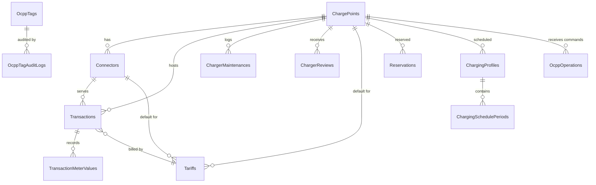
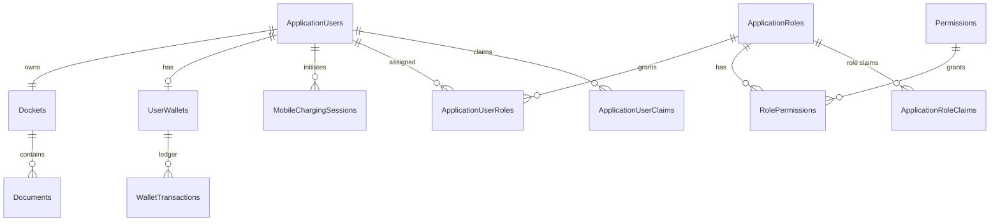
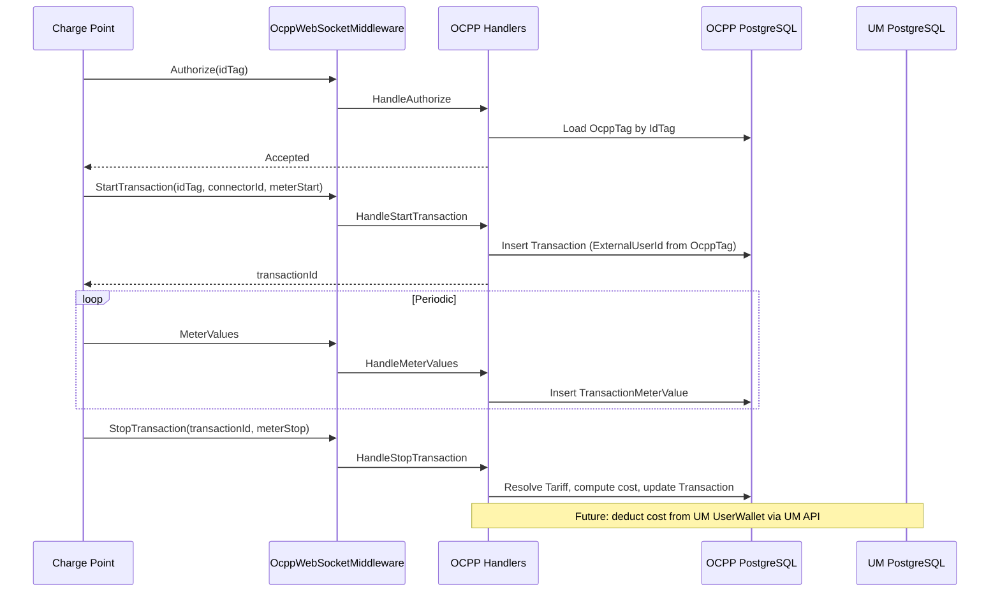
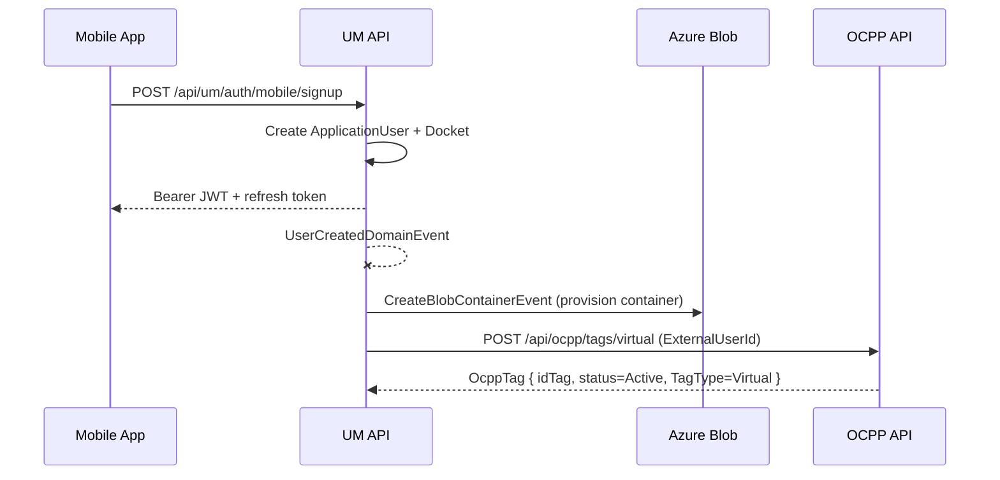

# Data Architecture

Both ChargeLK microservices use **PostgreSQL**, each with its own physical database and EF Core `DbContext`. There is no shared schema and no cross-database foreign keys — identifiers (`ExternalUserId`, `IdTag`) are used to bridge the two services.

| Service           | DbContext                                                   | Schema            | EF Core | Naming              |
| ----------------- | ----------------------------------------------------------- | ----------------- | ------- | ------------------- |
| OCPP Server       | `OcppServer.Infrastructure.Persistence.ApplicationDbContext`| `chargelk_ocpp`   | 8       | EF default (PascalCase entities; default column names) |
| User Management   | `ChargeLK.Infrastructure.Database.ApplicationDbContext`     | `public`          | 9       | `snake_case` via `EFCore.NamingConventions` + ASP.NET Identity tables |

Migrations live under each service's Infrastructure project (`Persistence/Migrations` for OCPP, `Migrations/` for UM). In Development the OCPP server applies migrations on startup (`app.ApplyMigrations()`); in Production, migrations are applied via an EF migration bundle produced by the deploy workflow.

---

## 1. OCPP Server Schema — `chargelk_ocpp`

### Entity overview

### Key entities

- **ChargePointEntity** (`ChargePoints`) — `ChargeBoxId` (natural id), location, vendor/firmware metadata, `ChargePointStatus`, `LastHeartbeatTimestamp`. Owns `Connectors`, `Transactions`, `Maintenances`.
- **Connector** — `(ChargePointId, ConnectorId)` tuple, `Status`, `ErrorCode`, `StatusTimestamp`.
- **TransactionEntity** (`Transactions`) — `IdTag` + `(ChargePointId, ConnectorId)`; start/stop timestamps & meter values; **UM integration fields** `ExternalUserId`, `TotalCost`, `TariffId`. Populated by the OCPP `StartTransaction` / `StopTransaction` handlers.
- **TransactionMeterValue** — per-reading entries (energy, voltage, current, phase) associated to a transaction.
- **OcppTag** — RFID/virtual/certificate/fleet-card identifiers. Lifecycle enum `TagStatus { Pending, Active, Suspended, Expired, Blocked, LostStolen, Deactivated, Revoked }`. `ExternalUserId` links to an `ApplicationUser` in UM.
- **OcppTagAuditLog** — immutable audit trail per status change/assignment/usage.
- **Tariff** — pricing plan with defaults and `ChargePointId`/`ConnectorId` scoping, peak-window pricing, session fees, min/max caps, `ValidFrom`/`ValidTo`. `Currency` defaults to `LKR`.
- **ChargerMaintenanceEntity** — maintenance log per charge point.
- **ChargerReview** — 1–5 star rating + optional message, user identity snapshot, `IsVisible` moderation flag.
- **Reservation / ChargingProfile / ChargingSchedulePeriod** — OCPP smart-charging primitives (scaffolded; not yet wired into end-user flows).
- **OcppOperation** — log of server-initiated OCPP calls (RemoteStart/Stop, Reset, etc.).

### Domain events

Entities inherit from `AuditableDomainEvent`. Examples fired on state change:

- `OcppTagCreatedEvent`, `OcppTagStatusChangedEvent`, `OcppTagAssignedEvent`, `OcppTagUnassignedEvent`, `OcppTagUsedEvent`.

Events are collected by the DbContext and published via MediatR `IPublisher` immediately after `SaveChangesAsync`.

---

## 2. User Management Schema — `public`

### Entity overview

### Key entities

- **ApplicationUser** : `IdentityUser<long>` + `FirstName`, `LastName`, `UserId` (Guid), `DocketId`, full audit fields, soft-delete (`IsDeleted`, `DeletedAt`). Raises `UserCreatedDomainEvent` on creation.
- **ApplicationRole / ApplicationUserRole / ApplicationUserClaim / ApplicationRoleClaim / ApplicationUserLogin / ApplicationUserToken** — standard ASP.NET Identity tables with `long` keys.
- **Permission** — `Name`, `Resource`, `Action` (all normalized lowercase). System permissions cannot be deleted.
- **RolePermission** — many-to-many join between `ApplicationRole` and `Permission` with `GrantedAt` / `GrantedBy`.
- **Docket** — per-user document bundle (1:1 with `ApplicationUser`).
- **Document** — `FileName`, `ContentType`, `FileSize`, `Path`, `ThumbnailPath`, `DocumentCategory`, `DocumentStatus`. Persisted metadata; the blob itself lives in Azure Blob Storage.
- **UserWallet** — per-user balance in LKR, `IsActive`, `LastTransactionAt`.
- **WalletTransaction** — ledger: `TransactionType`, `Amount`, `BalanceBefore/After`, `ReferenceId`, `PaymentGatewayTransactionId`.
- **MobileChargingSession** — mobile-initiated session lifecycle. Tracks `SessionStatus` (`PENDING`/`ACTIVE`/`COMPLETED`/`FAILED`), `OcppTransactionId`, reserved balance, final cost, `WalletTransactionId`.
- **SystemSettings** — key/value/category store. Categories: `General`, `Notifications`, `Security`, `Appearance`. Predefined keys in `SettingKeys` (e.g. `CompanyName`, `AutoLogoutTimeout`, `MinPasswordLength`).

### Seeded data

On UM startup:

1. Roles: `SystemAdmin`, `Admin`, `Operator`, `Support`, `User` (from `Roles.cs`).
2. Permissions: the full catalog in `Permissions.cs` (resource:action pairs for users, roles, permissions, charge points, tags, tariffs, transactions, wallet, documents, settings).
3. Default `RolePermission` grants (e.g. `SystemAdmin` grants everything).

### Soft-delete & auditing

`ApplicationUser`, `Permission`, and entities deriving from `BaseAuditableDomainEntity<T>` support `IsDeleted`, `DeletedAt`, `DeletedBy`. Cross-cutting `CreatedAt/By` and `UpdatedAt/By` are populated via `SetAuditInfo`.

### Domain events

- `UserCreatedDomainEvent` — fan-out:
  - Handler in UM publishes `CreateBlobContainerEvent` for the user's document storage.
  - Handler in UM also calls the OCPP server's `POST /api/ocpp/tags/virtual` to create a virtual OCPP tag and bind it to the user.
- `CreateBlobContainerEvent` — handled by an `IBlobStorageService` to provision a per-user container.

---

## 3. Cross-Service Data Bridges

Because the two services have separate databases, cross-service references are by **identifier only**, not by foreign key.

| Bridge                                  | How it's established                                                                                      |
| --------------------------------------- | --------------------------------------------------------------------------------------------------------- |
| UM user → OCPP tag                      | On `UserCreatedDomainEvent`, UM calls `POST /api/ocpp/tags/virtual`. The tag stores `ExternalUserId` (GUID as string). |
| OCPP transaction → UM user              | `TransactionEntity.ExternalUserId` is set by the StartTransaction handler when it matches the `IdTag` to a tag with an `ExternalUserId`. |
| Admin portal → both services            | JWT issued by UM is accepted by OCPP server via a shared-secret scheme. `baseApi.ts` uses the same token for `/api/ocpp/*` and `/api/um/*` calls. |
| Mobile summary                          | `MobileSummaryController` in UM calls the OCPP bridge endpoints `/api/ocpp/mobile/user/{userId}/*` to fetch session/transaction aggregates. |

---

## 4. Storage & External State

- **PostgreSQL** — one database per service (separate connection strings). EF Core owns migrations.
- **Azure Blob Storage** — user documents + thumbnails. Containers are created on demand per user (`CreateBlobContainerEvent`). Thumbnails generated with `SixLabors.ImageSharp` during upload.
- **Azure Service Bus** — UM's `AzureServiceBusPublisher` / `AzureServiceBusSubscriber` are wired in `ChargeLK.Infrastructure`. Used as the outbound integration bus for cross-service / async events. OCPP server does **not** publish to Service Bus today.
- **In-memory state** — `OcppServerService` holds the live WebSocket map by `chargeBoxId`. It is not persisted; on restart, charge points must re-send `BootNotification`.

### Note on `MongoDbContext`

A `MongoDbContext` file exists in `ChargeLK.Infrastructure.Database/` but is **not** registered in the DI container and the service does not take a runtime dependency on MongoDB. PostgreSQL is the sole live database.

---

## 5. Data Flow Examples

### A. Charging transaction lifecycle

### B. Mobile user onboarding

---

## Related Documentation

- [System Architecture](../02-Architecture/README.md)
- [Components Documentation](../03-Components/README.md)
- [API Reference](../04-API-Reference/README.md)
- [Security](../08-Security/README.md)
